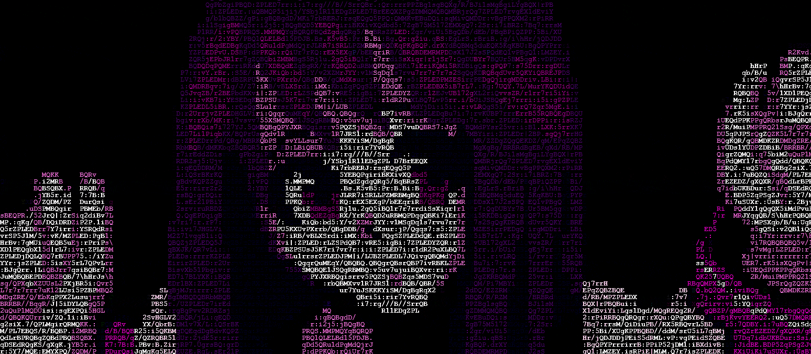

 

  

---

## whoami

Soy **Jason** — estudiante de Ingeniería en Sistemas y Redes Informáticas en Usulután, El Salvador. Me especializo en **ciberseguridad ofensiva (Red Team)**, **infraestructura de telecomunicaciones Cisco (CCNA Path)**, **virtualización con Proxmox VE** y **hardware hacking** con microcontroladores (ESP32, Raspberry Pi y BadUSB). Desarrollo herramientas de seguridad modulares como [**DragonFly**](https://github.com/whoamijas0n/DragonFly) y [**Soranin**](https://github.com/whoamijas0n/Soranin), y actualmente profundizo en arquitecturas de red y analítica defensiva, abierto a retos técnicos e investigación colaborativa.

> *"Las soluciones más elegantes nacen cuando combinas ataque y defensa."* — **Jason Caballero** (<code>@whoamijas0n</code>)

 

---

## Connect with Me

  
  
  
  

 

---

## Tech Stack

### Cybersecurity & Offensive Security

  
  
  
  
  
  
  

### Networking & Infrastructure

  
  
  
  
  
  

### Languages & Development

  
  
  
  
  
  

### Databases & Storage

  
  
  

### Hardware & IoT Engineering

  
  
  
  
  

### Operating Systems & Platforms

  
  
  
  
  
  

 

---

## GitHub Analytics

  

  

  
  

 

---

## Awards & Recognition

<table align="center" width="100%">
  <tr>
    <td align="center" width="50%">
       
      <strong>Desarrollo de Software</strong> 
      FLIA UGB · 2026
    </td>
    <td align="center" width="50%">
       
      <strong>CONINFO Nacional</strong> 
      ASPROC · 2026
    </td>
  </tr>
  <tr>
    <td align="center" width="50%">
       
      <strong>Robótica & IoT</strong> 
      FLIA UGB · 2025
    </td>
    <td align="center" width="50%">
       
      <strong>Automatización</strong> 
      FLIA UGB · 2025
    </td>
  </tr>
</table>

 

---

## Certifications & Credentials

<table align="center" width="100%">
  <tr>
    <td align="center" width="50%">
       
      <strong>Network Technician Career Path</strong> 
      Cisco Networking Academy 
      
    </td>
    <td align="center" width="50%">
       
      <strong>Jr. Cybersecurity Analyst Path</strong> 
      Cisco Networking Academy 
      
    </td>
  </tr>
</table>

 

---

## Featured Projects

<table align="center" width="100%">
  <tr>
    <td width="50%" valign="top">
      <h3 align="center">DragonFly System</h3>
      

        
      

      
Suite modular para operaciones ofensivas de Red Team. Automatiza auditorías inalámbricas, captura de handshakes, ataques BadUSB/HID y manipulación RF.

      

        
        
        
        
      

    </td>
    <td width="50%" valign="top">
      <h3 align="center">Soranin OSINT</h3>
      

        
      

      
Framework de inteligencia de fuentes abiertas (OSINT) diseñado para automatizar investigaciones digitales asíncronas, correlación de identidades y detección de filtraciones.

      

        
        
        
      

    </td>
  </tr>
  <tr>
    <td width="50%" valign="top">
      <h3 align="center">ServoPipe </h3>
      

        
      

      
Brazo robótico controlado por gestos en tiempo real mediante visión computacional con MediaPipe y comunicación serial de baja latencia hacia ESP32.

      

        
        
        
        
      

    </td>
    <td width="50%" valign="top">
      <h3 align="center">REI Hub</h3>
      

        
      

      
Dispositivo autónomo de campo para diagnóstico y mantenimiento de infraestructura TI basado en Raspberry Pi Zero 2W con pantalla OLED y UI asíncrona.

      

        
        
        
      

    </td>
  </tr>
  <tr>
    <td width="50%" valign="top">
      <h3 align="center">FiExpress</h3>
      

        
      

      
Sistema integral de control de asistencia con lectura biométrica/RFID, backend en .NET C#, SQL Server y alertas en tiempo real vía Telegram.

      

        
        
        
      

    </td>
    <td width="50%" valign="top">
      <h3 align="center">HandTalk</h3>
      

        
      

      
Software de accesibilidad inclusiva para traducción y reconocimiento de lengua de señas en tiempo real utilizando webcam y redes neuronales.

      

        
        
        
      

    </td>
  </tr>
</table>

 

---

## Overview

  
  &nbsp;&nbsp;&nbsp;&nbsp;
  
  &nbsp;&nbsp;&nbsp;&nbsp;
  
  &nbsp;&nbsp;&nbsp;&nbsp;
  

  

  

